<div align="center">

# pincite

**Evidence-grade research skills for Claude, and the tested tooling that keeps them honest.**

[](https://github.com/elianashor/claude-skills/actions/workflows/ci.yml)
[](https://github.com/elianashor/claude-skills/releases)

[](LICENSE)

</div>

A citation table or a testimony prep sheet fails in one of a few predictable ways. A quote gets cut mid-word. A number drifts from its source. A pin cite points one paragraph off. A row summarizes a paper nobody opened. These skills were built on real expert-report work to stop those failures. Every rule that a machine can check comes with a tested script that checks it.

```text
$ pincite check examples/pincheck/report.txt --scan examples/pincheck/sheet.md --negative-control 6
FAIL number '412' @ ¶ 43 [segment 7]: not at ¶ 43; found at ¶ 40
     in: Pass-through ; Measured on all 412 plans ; ¶ 43
-- 4 claim(s), 5 check(s): 4 verified, 1 failed
  caught: number '$1,240' -> '$1,242' at ¶ 41
  caught: number '12.5%' -> '12.7%' at ¶ 41
  caught: number '87' -> '83' at ¶ 43
  caught: quote 'disciplined price throughout the period' -> 'never price throughout the period' at ¶ 41
-- negative control: 4/4 corruptions caught
```

The checker found the one planted error, said it was a wrong pin rather than an invented number, and then proved it would have caught a changed digit or a swapped word.

## What's inside

### Skills

| Plugin | Skill | What it does |
|---|---|---|
| `citation-table` | [`citation-table`](plugins/citation-table/skills/citation-table/SKILL.md) | Builds or audits a litigation-grade citation table in three modes: audit our report's citations, build supporting authority for a draft, or attack an opposing report's citations. Every source is read in full. Every quote is character-verified with a pin cite. Funding, conflicts and later rebuttals sit on the row face. |
| `cheat-sheets` | [`cheat-sheet`](plugins/cheat-sheets/skills/cheat-sheet/SKILL.md) | Teaches one section of a source to a reader who must perform from memory. Covers testimony prep, answering an opposing document, multi-document sets, and a study mode for course material. |
| `cheat-sheets` | [`teaching-cheat-sheet`](plugins/cheat-sheets/skills/teaching-cheat-sheet/SKILL.md) | The same method for any authoritative source: a story page, module summaries, audited diagrams, expected challenges with spoken answers. |
| `cheat-sheets` | [`prep-sheet`](plugins/cheat-sheets/skills/prep-sheet/SKILL.md) | A lighter sheet that works from whatever the user provides and folds format corrections back into itself. |
| `cheat-sheets` | [`expert-report-section-cheat-sheet`](plugins/cheat-sheets/skills/expert-report-section-cheat-sheet/SKILL.md) | The testimony version for one section of a testifying expert's report, with cross-examination questions drawn from the trial team's mock cross. |

### The `pincite` toolkit

| Command | Checks or builds | Backs which rule |
|---|---|---|
| `pincite footnotes` | Separates body, footnotes and superscript markers by font size, so each citing quotation is the complete sentence around its marker. Joins footnotes that cross a page break. Finds the running header by position, not frequency. | Excerpts are located, read and transcribed, never cut from a character window. |
| `pincite build` | Builds a supporting, audit, opposing or adverse workbook from row JSON. It rebuilds from a model, rejects keys the schema does not know, refuses section keys missing from the TOC, then reloads the file to verify it. | One schema, no invented structure, no merged-cell corruption. |
| `pincite sweep` | Every cell of every sheet: truncation, unbalanced quotes, scaffolding, artifacts, template rot, empty required cells, missing links, Detail rows out of step. | QC gates 1 to 4. |
| `pincite qc` | What the cells mean: mid-word quotes, running headers leaking into quotes, bare flags, unread sources that still get rated, process residue, relevance off the 1 to 5 scale, venue inflation, unearned superlatives. | Parts of QC gates 6, 12, 14, 15 and 20. |
| `pincite units` / `check` | Rebuilds Word's auto-numbered paragraphs (which the text layer does not contain), then checks every number and quotation in every pin-cited sentence or table row. A negative control corrupts facts and requires every one to fail. | "Mechanically verify every (pin cite, fact) pair, and prove the checker." |
| `pincite guard` | Blocks case material from a public repo. Private terms come from a CI secret, never the repo. Built-in patterns catch case numbers, Bates ranges, protective-order legends and dated draft filenames. It scans full git history and masks its output in CI. | Confidentiality by default. |
| `pincite lint` | SKILL.md frontmatter, every referenced file, plugin manifests, the marketplace, and drift between vendored scripts and `src/`. | A skill never sends the model to a missing file. |

## Install

**Claude Code.** Add this repository as a plugin marketplace, then install either plugin.

```text
/plugin marketplace add elianashor/claude-skills
/plugin install citation-table@pincite
/plugin install cheat-sheets@pincite
```

**Claude apps.** Download a skill `.zip` from the [latest release](https://github.com/elianashor/claude-skills/releases/latest) and upload it as a custom skill. Each zip carries its own scripts, so it runs without installing anything else.

**The toolkit on its own.**

```bash
pip install "pincite @ git+https://github.com/elianashor/claude-skills"
pincite --help
```

## Try it in a minute

```bash
git clone https://github.com/elianashor/claude-skills && cd claude-skills
pip install -e .
pincite build examples/citation-table/spec.json --out /tmp/Supporting_Authority.xlsx
pincite qc /tmp/Supporting_Authority.xlsx --strict
pincite check examples/pincheck/report.txt --scan examples/pincheck/sheet.md --negative-control 6
```

Everything in [`examples/`](examples/) is synthetic.

## How a citation table gets built

```mermaid
flowchart LR
    A[Intake<br/>one batched interview] --> B[Manuscript<br/>claims map from the real TOC]
    B --> C[Reference inventory<br/>dedup, never auto-merge]
    C --> D[Read in full<br/>parallel batches, row JSON on disk]
    D --> E[Fresh-eyes verify<br/>quotes, figures, pins]
    E --> F[Stress-test<br/>adverse rows split off]
    F --> G[pincite build<br/>model rebuild + reload check]
    G --> H[pincite sweep + qc<br/>ledger to zero]
    H --> I[Delivery<br/>one file to open]
```



The pipeline, the five standing checks, the twenty QC gates and the failure catalog live in the skill's [`references/`](plugins/citation-table/skills/citation-table/references/). Each failure in the catalog happened at least once on a real build, and each one now has a prevention rule.

## Design principles

- **Read in full or leave it out.** An abstract is not a read. An unread source gets an honest `○ Unverified` row that asserts nothing.
- **A hole beats a bad patch.** No invented identifiers, no guessed sections, no figure that cannot be pointed to in the source.
- **Prove the checker.** A verifier that has never been shown to fail has proven nothing, so `pincheck` runs a negative control.
- **One source of truth.** Scripts live in `src/pincite/` and are copied into each skill by `tools/sync_scripts.py`. CI fails on any drift, so an uploaded skill runs the same tested code.
- **Confidential by default.** These skills came from client work. Case names, parties, file names, source titles and figures were removed before publishing. The guard and the skills' own self-update rules keep it that way.

## Repository layout

```text
.claude-plugin/marketplace.json   plugin marketplace (Claude Code)
plugins/citation-table/           plugin: citation-table skill + references + scripts
plugins/cheat-sheets/             plugin: four cheat sheet skills + pincheck
src/pincite/                      the toolkit (canonical source of every script)
tests/                            pytest suite on synthetic PDFs, DOCX files and workbooks
tools/                            script sync and reproducible release bundles
.github/workflows/                CI, confidentiality guard, release
```

## Contributing

See [CONTRIBUTING.md](CONTRIBUTING.md). Report a suspected leak privately as described in [SECURITY.md](SECURITY.md).

## License

[MIT](LICENSE)
